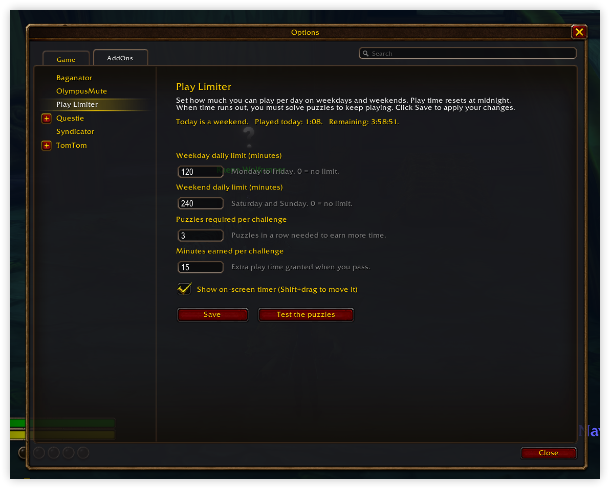
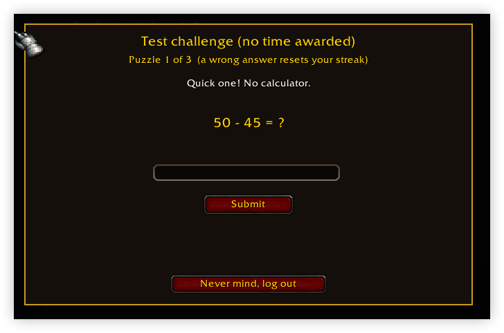
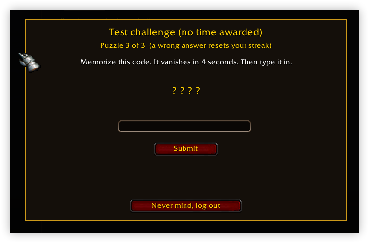
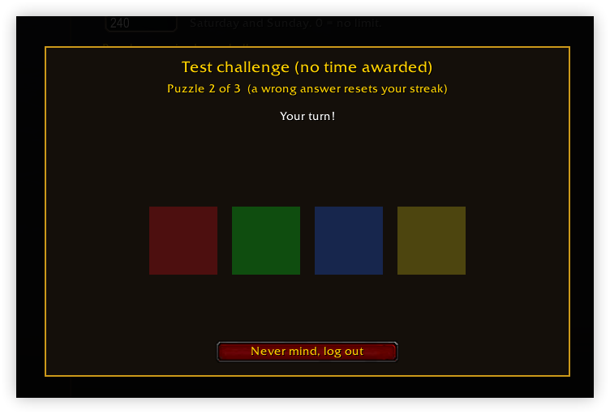
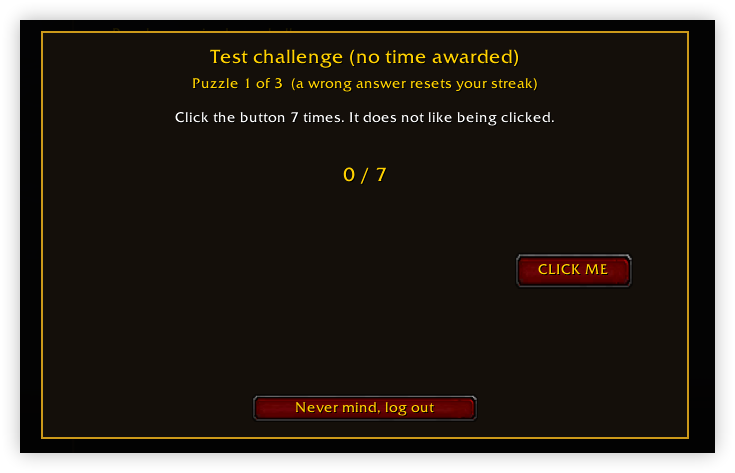
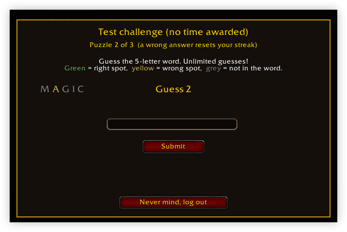

# PlayLimiter

A World of Warcraft addon (built for WoW Classic / Anniversary, interface `16001`) that limits my playtime like a normal person.

You set how long a play session may last on weekdays and weekends. When the time runs out, a full-screen overlay blocks the game until you solve a run of annoying puzzles to earn a bit more time, or you give up and log out.



## Features

- **Separate weekday and weekend limits.** Monday to Friday and Saturday/Sunday each get their own session length. Set either to `0` for no limit.
- **On-screen countdown timer.** Shows how much time is left this session. It turns orange at 5 minutes and red at 1 minute. Shift+drag to move it.
- **Warnings** at 10, 5 and 1 minute remaining, with a chat message, an on-screen alert and a raid-warning sound.
- **Puzzle challenge when time is up.** Solve several puzzles in a row (3 by default) to earn extra minutes (15 by default). A wrong answer resets your streak to zero.
- **Combat-safe.** If the limit is reached mid-fight, the challenge waits until combat ends.
- **Sessions survive short breaks.** Logging out and back in resumes the same session. Only a break longer than the configured length (30 minutes by default) starts a new session.
- **No cheating your way out.** Loosening any setting (more time, fewer puzzles, bigger bonus, shorter break) requires passing the puzzle challenge first. Tightening a setting is always free.
- **"Never mind, log out" button** on the challenge screen if you would rather just stop.

## Puzzles

Each challenge picks puzzles at random, never the same kind twice in a row.

| Puzzle | What you do |
| --- | --- |
| Mental arithmetic | Solve something like `(12 x 7) + 43 - 18` with no calculator. |
| Vanishing code | Memorize a 6-character code that disappears after 4 seconds, then type it **backwards**. |
| Pattern repeat | Watch four coloured squares flash in sequence, then repeat it. The pattern grows longer as your streak goes up. |
| Word scramble | Unscramble a WoW word such as `STORMWIND` or `THUNDERFURY`. |
| Runaway button | Click a button 7 times while it keeps jumping around the panel. |

### Screenshots

**Mental arithmetic**



**Vanishing code**



**Pattern repeat**



**Runaway button**



**Word puzzle**



## Installation

1. Download or clone this repository.
2. Copy the inner `PlayLimiter` folder (the one containing `PlayLimiter.toc` and `PlayLimiter.lua`) into your WoW AddOns directory, for example:
   ```
   World of Warcraft\_anniversary_\Interface\AddOns\PlayLimiter
   ```
3. Restart the game or type `/reload`, and make sure **Play Limiter** is enabled in the AddOns list on the character select screen.

## Usage

Open the settings with `/pl` or `/playlimit`, or go to **Game Menu > Options > AddOns > Play Limiter**.

| Setting | Default | Description |
| --- | --- | --- |
| Weekday session limit | 120 min | Monday to Friday. `0` = no limit. |
| Weekend session limit | 240 min | Saturday and Sunday. `0` = no limit. |
| Puzzles required per challenge | 3 | Puzzles in a row needed to earn more time. |
| Minutes earned per challenge | 15 | Extra play time granted when you pass. |
| Break that starts a new session | 30 min | Time logged out before your session counter resets. |
| Show on-screen timer | On | Toggle the countdown display. |

Click **Save** to apply changes. Click **Test the puzzles** to try a challenge without earning any time.

The settings panel also shows whether today counts as a weekday or weekend, how long you have played this session, and how much time remains.

## How time is tracked

- Time only counts while you are logged in, and it pauses while a challenge is on screen.
- Passing a challenge sets your remaining time to exactly the bonus amount, so going over the limit is not rewarded.
- Settings and session progress are saved per account in the `PlayLimiterDB` saved variable.

## License

See [LICENSE](LICENSE).
